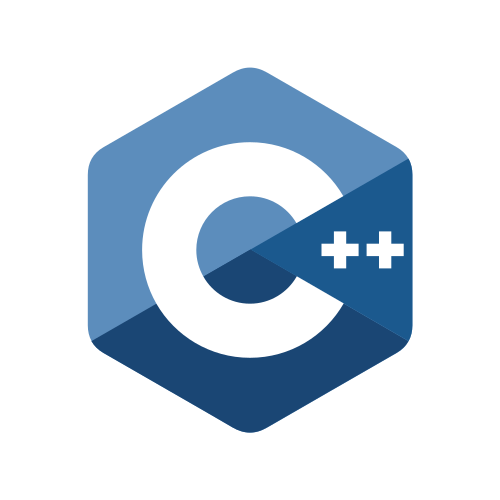
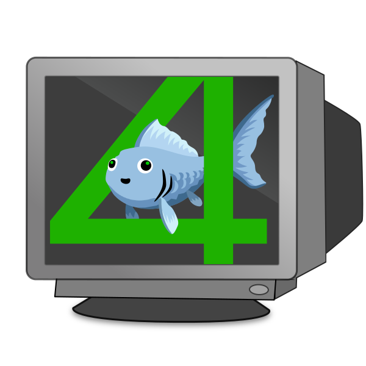
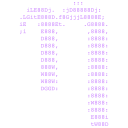

# Kou-ding

    <table>
        <!-- Table Row -->
        <tr>
            <!-- Table Data -->
            <td align="center">
            
            </td>
            <!-- Table Data -->
            <td align="center" width="250">
            <a href="https://kou-ding.github.io/" style="font-size: 30px;">🔗 My Website</a>
            </td>
        </tr>
    </table>

 <b>⚙️ Backend Development</b> 

    <table>
        <!-- Table Row -->
        <tr>
            <!-- Table Data -->
            <td align="center">
            <b>C</b> 
             
            </td>
            <td align="center">
            <b>C++</b> 
             
            </td>
            <td align="center">
            <b>Java</b> 
             
            </td>
            <td align="center">
            <b>Python</b> 
             
            </td>
        </tr>
        <tr>
            <td align="center">
            <b>Matlab</b> 
            
            </td>
            <td align="center">
            <b>Julia</b> 
            
            </td>
            <td align="center">
            <b>Cuda</b> 
            
            </td>
        </tr>
    </table>

 <b>🌍 Frontend Development</b> 

    <table>
        <!-- Table Row -->
        <tr>
            <!-- Table Data -->
            <td>
            <b>HTML</b> 
             
            </td>
            <td align="center">
            <b>CSS</b> 
             
            </td>
        </tr>
    </table>

 <b>🗄️ Databases</b> 

    <table>
        <!-- Table Row -->
        <tr>
            <!-- Table Data -->
            <td align="center">
            <b>MySQL</b> 
             
            </td>
            <td align="center">
            <b>SQLite</b> 
             
            </td>
            <td align="center">
            <b>MongDB</b> 
             
            </td>
        </tr>
    </table>

 <b>🚀 Development frameworks & Tools</b> 

    <table>
        <!-- Table Row -->
        <tr>
            <!-- Table Data -->
            <td align="center">
            <b>Docker</b> 
             
            </td>
            <td align="center">
            <b>Arduino</b> 
             
            </td>
            <td align="center">
            <b>Android Studio</b> 
             
            </td>
            <td align="center">
            <b>Godot</b> 
             
            </td>
            <td align="center">
            <b>FastAPI</b> 
             
            </td>
        </tr>
    </table>

 <b>🔁 Version Control</b> 

    <table>
        <!-- Table Row -->
        <tr>
            <!-- Table Data -->
            <td align="center">
            <b>git</b> 
             
            </td>
            <td align="center">
            <b>Github</b> 
             
            </td>
        </tr>
    </table>

 <b>🐚 Shells</b> 

    <table>
        <!-- Table Row -->
        <tr>
            <!-- Table Data -->
            <td align="center">
            <b>Bash</b> 
             
            </td>
            <td align="center">
            <b>Zsh</b> 
             
            </td>
            <td align="center">
            <b>Fish</b> 
             
            </td>
            <td align="center"> 
        </tr>
    </table>

 <b>⌨️ Text Editors / IDEs</b> 

    <table>
        <!-- Table Row -->
        <tr>
            <!-- Table Data -->
            <td align="center">
            <b>VSCode</b> 
             
            </td>
            <td align="center">
            <b>Vim</b> 
             
            </td>
            <td align="center">
            <b>Nano</b> 
             
            </td>
            <td align="center"> 
        </tr>
    </table>

 <b>🐧 Operating Systems</b> 

    <table>
        <!-- Table Row -->
        <tr>
            <!-- Table Data -->
            <td align="center">
            <b>Arch Linux</b> 
             
            </td>
            <td align="center">
            <b>Fedora</b> 
             
            </td>
            <td align="center">
            <b>Debian</b> 
             
            </td>
            <td align="center">
            <b>Kali Linux</b> 
             
            </td>
            <td align="center">
            <b>Windows</b> 
             
            </td>  
        </tr>
    </table>

 <b>🎲 Misc</b> 

    <table>
        <tr>
            <td align="center">
            <b>LaTex</b> 
            
            </td>
            <td align="center">
            <b>Gherkin</b> 
            
            </td>
        </tr>
    </table>

